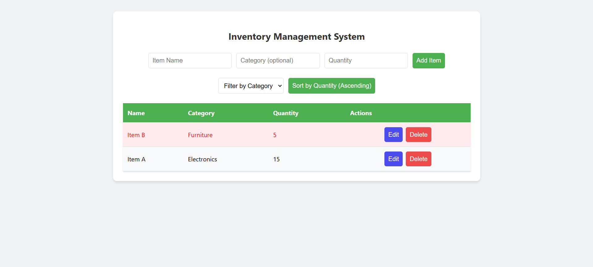

# Dynamic Inventory Management Table

## Description

A simple dynamic inventory management system implementation to track and manage items in stock.

## Features

- Add, update, and remove inventory items
- Edit and Delete Existing items
- Filter the table by item category
- Sort item by quantity
- Highlight low-stock items(below 10 quantity)

## Setup

1. Clone the repository
2. Install required dependencies
3. Follow configuration instructions

## Run Command

```
  npm run dev
```

## Technologies Used

- Reactjs with vite
- CSS
- Javascript

## Screenshots



Last updated: 2026-10-20 16:46 UTC
